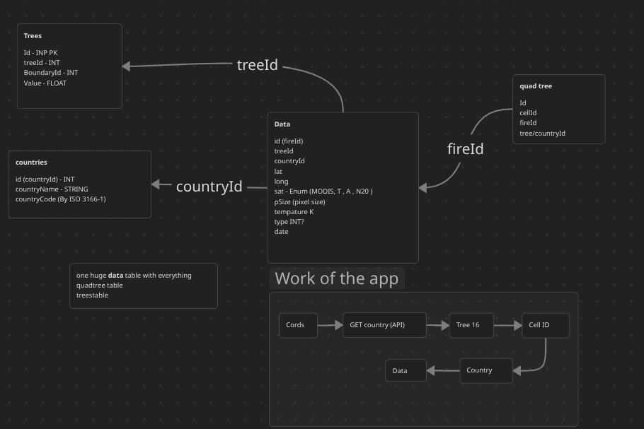

# Harmonized Burning Activity Calendar

A web application that visualizes worldwide active-fire hotspots on an **interactive map**, combining the long historical record of **MODIS** (early 2000s onward) with the continuity and finer spatial detail of **VIIRS** into one consistent time series.

---

## Table of Contents

1. [Overview](#overview)
2. [Features](#features)
3. [Project Phases](#project-phases)
4. [Database Schema](#database-schema)
5. [How a Query Works](#how-a-query-works)
6. [Getting Started](#getting-started)
7. [Usage](#usage)
8. [Data Sources](#data-sources)
9. [Project Structure](#project-structure)
10. [Project Tools](#project-tools)
11. [Roadmap](#roadmap)
12. [License](#license)

---

## Overview

Active-fire hotspot data comes from multiple satellite sensors,  each with different resolutions, overpass times and detection characteristics. This makes it hard to compare fire activity across decades: a jump in hotspot counts may reflect a sensor change rather than a real change in burning.

This project:

- Provides a **web app** where users can select a region and a date range, explore fires on a map, and visualize analytics.
- Presents a **calendar of burning activity** (early 2000s to present) that helps emergency managers understand the fire history of an area.

## Features

- 🗺️ **Interactive world map** of recorded fire hotspots
- 📍 **Region selection** (country, or custom area drawn on the map)
- 📅 **Date-range filtering**
- 🗓️ **Burning activity calendar** – hotspot counts per month/year from the early 2000s to present
- 📈 **Analytics & charts** – seasonality, yearly totals, trends, anomalies
- 🛰️ **Harmonized data** – MODIS + VIIRS (S-NPP / NOAA-20) unified

## Project Phases

### Phase 1 – MODIS & VIIRS Harmonization

Build the pipeline that transforms raw MODIS and VIIRS detections into a single, consistent dataset.

- Ingest raw hotspot files from each sensor.
- Normalize fields (coordinates, date/time, confidence, brightness temperature, pixel size, etc.).
- Account for differences in spatial resolution (MODIS ~1 km vs. VIIRS ~375 m) and overpass times.
- Align/overlap the sensors' periods to calibrate and validate the harmonization.
- Output a unified dataset.

### Phase 2 – Web Application

Build the visual tool that consumes the harmonized data.

- Region and date-range selection.
- Map visualization of hotspots.

## Database Schema

### Design summary

The schema is built around **one large `Data` table** holding every hotspot, plus a **quadtree table** and a **trees table** for fast spatial lookup.

| Table         | Purpose                                                                                                                                            |
| ------------- | -------------------------------------------------------------------------------------------------------------------------------------------------- |
| **Data**      | Main table with every harmonized hotspot (`id`/`fireId`, `treeId`, `countryId`, `lat`, `long`, `sat`, `pSize`, `temperature` (K), `type`, `date`). |
| **countries** | Country lookup: `id` (`countryId`), `countryName`, `countryCode` (ISO 3166-1).                                                                     |
| **Trees**     | Quadtree node definitions: `Id` (PK), `treeId`, `BoundaryId`, `Value`.                                                                             |
| **quad tree** | Maps a cell to its fires: `Id`, `cellId`, `fireId`, `tree/countryId`.                                                                              |

**Relations**

- `Data.treeId` → `Trees`
- `Data.countryId` → `countries`
- `Data.fireId` ↔ `quad tree`

**Notable fields**

- `sat` – enum of the source sensor: `MODIS`, `T` (Terra), `A` (Aqua), `N20` (NOAA-20)
- `pSize` – pixel size
- `temperature` – brightness temperature in Kelvin

## How a Query Works

The app resolves a location to its data through the quadtree rather than scanning the whole table:

`Coords → GET country (API) → Tree  → Cell ID → Country → Data`

1. The user provides coordinates (or selects a region).
2. The country is resolved through an API call.
3. The coordinates are mapped to a quadtree.
4. The resulting **Cell ID** is used to find the matching country/cell.
5. The related hotspots are fetched from the **Data** table.

## Getting Started

### Installation

...

### Running the app

...

## Usage

...

## Data Sources

- **MODIS Active Fire** (Terra & Aqua) – NASA FIRMS
- **VIIRS Active Fire** (S-NPP & NOAA-20) – NASA FIRMS
- **Country boundaries** – ISO 3166-1 country codes

Data from [NASA FIRMS](https://firms.modaps.eosdis.nasa.gov/) (Fire Information for Resource Management System).

## Project Structure

...

## Project Tools

- MS SQL Server;
- C#, .NET and Entity Framework;
- React;
- ...

## Roadmap

- [ ] Ingest MODIS and VIIRS data
- [ ] Define and validate harmonization method
- [ ] Build database and quadtree indexing
- [ ] Build backend API
- [ ] Map with region and date selection
- [ ] Analytics and visualizations

## License

- MIT
